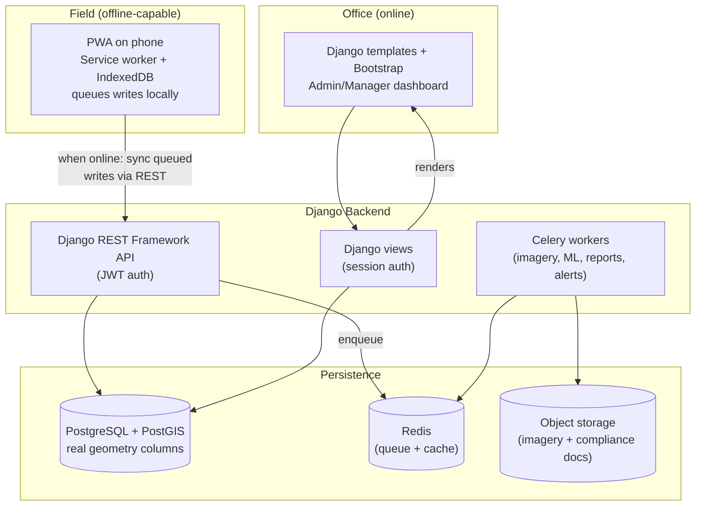

# Architecture

## Tech stack

| Layer | Choice | Why |
|---|---|---|
| Backend framework | Django 5.2 LTS (supported into April 2028), Python 3.12+ | Batteries-included: auth, admin panel, ORM, migrations |
| Geospatial | GeoDjango + PostgreSQL/PostGIS, real `PointField`/`PolygonField` | Trees, block boundaries, and image bounding boxes are actual queryable geometry, never text strings |
| API layer | Django REST Framework | Required for the offline/mobile client — there is no server-rendered-only path for field data |
| Auth (web) | Django session auth | Office/admin dashboard (Manager, Super Admin) |
| Auth (API/mobile) | `djangorestframework-simplejwt` | The offline-capable client authenticates once, then keeps working without a live connection |
| Field client | Progressive Web App — service worker + IndexedDB + background sync queue | See `05-offline-sync.md`. Installable to a phone home screen, no app store required |
| Admin/desktop UI | Django templates + Bootstrap 5 | Office staff work from a desk with internet; no need to force everyone onto the offline client |
| Background jobs | Celery + Redis | Imagery processing, detection/classification, reports, notifications |
| File storage | Django Storages + S3-compatible bucket (local disk fallback for dev) | Uploaded imagery and compliance documents |
| Testing | pytest-django | Written alongside each phase, not only at the end |
| CI | GitHub Actions | Tests + linting on every push (added in the final build phase) |
| Containerization | Docker Compose (web, worker, beat, Postgres/PostGIS, Redis) | Local dev today; the same compose file is the foundation for whatever deployment target comes later |

## High-level system diagram

## Project structure

Django "apps by domain," not one monolithic app. See `CLAUDE.md` for the directory layout — it's the canonical version; don't duplicate-maintain it here.

## Key architectural constraints (see `CLAUDE.md` for the full list)

- No text-string coordinates anywhere — every location/boundary field is a real GeoDjango geometry field with PostGIS backing it.
- No JSON API surface exists in the original app; this rebuild's API is not a port of existing endpoints, it's designed from scratch around what the offline client and detection/classification pipeline actually need (see `04-api-spec.md`).
- Local-first: nothing here assumes a specific deployment target. `docker-compose.yml` at the repo root is the only infrastructure definition that should exist until the local build plan (`02-build-plan.md`) is fully verified.
